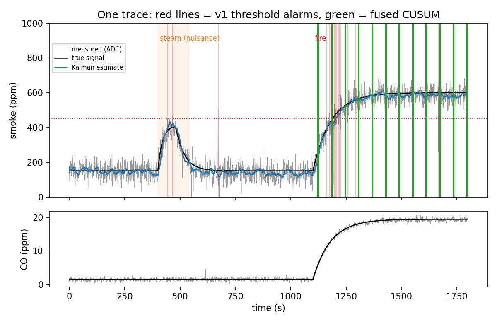
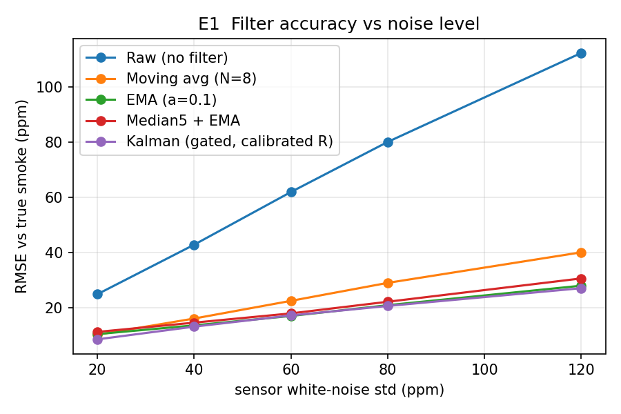
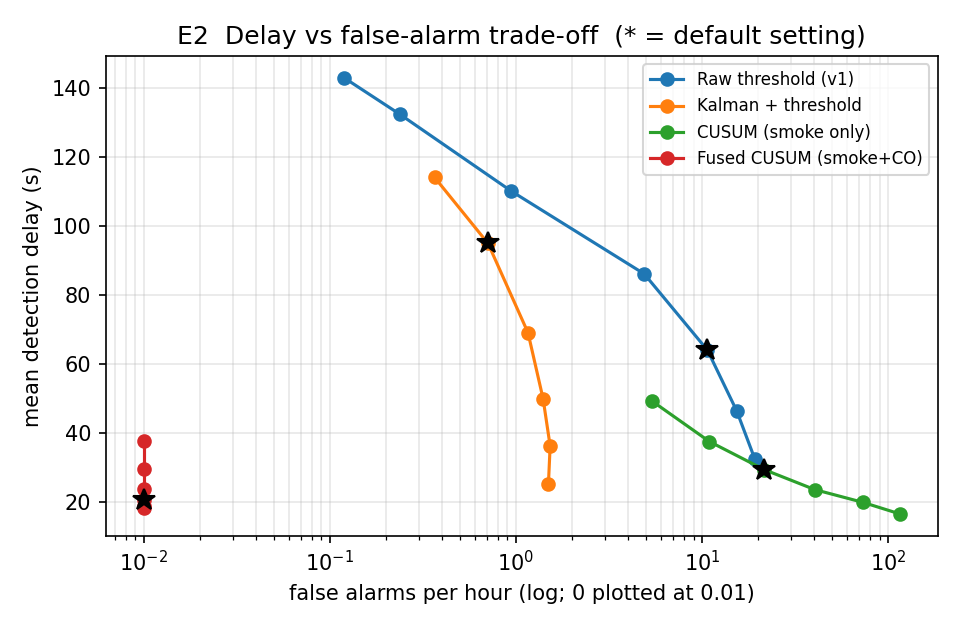
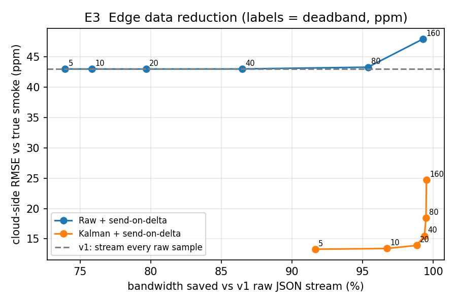
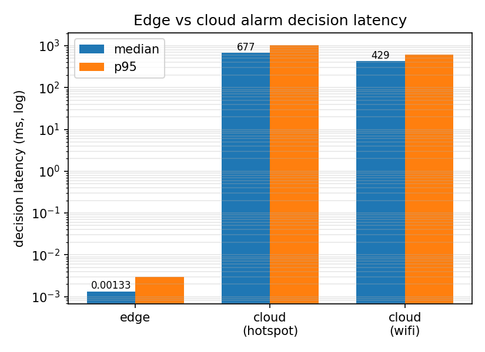

# Edge-to-Cloud IoT Smoke Sensing: Signal Processing, Detection & Streaming

A real-time IoT pipeline for multi-gas smoke detectors, extended from a
cloud data-streaming project (v1, 2023) into an **edge signal-processing
study** (v2): how much can on-device filtering, change detection and sensor
fusion improve detection speed, false-alarm rate and uplink bandwidth before
data ever reaches the cloud?

## Key results (v2)

> Across 300 simulated runs, the edge pipeline cut mean fire-detection delay
> from **64 s to 20 s** and used **98.8% less bandwidth** than streaming raw
> readings. Separately, on real networks, an on-device alarm decision took
> **under 1 ms**, versus a median **~430–680 ms** for a cloud decision over
> Wi-Fi and cellular.

**Simulated:** Monte Carlo over 300 simulated 30-minute recordings (130 fires, 159
steam/cooking nuisance events, ~126 h of non-fire data). Full tables in
[`v2/results/results.md`](v2/results/results.md).

| | v1 (raw stream + `smoke > 450`) | v2 (edge DSP) |
|---|---|---|
| Smoke estimate error (RMSE vs truth) | 42.9 ppm | **13.2 ppm** (gated Kalman, −69%) |
| False alarms | 10.7 / hour | **0 in ~126 h** (smoke + CO fused CUSUM) |
| Mean detection delay | 64 s | **20 s** (100% of fires detected) |
| Uplink messages | 3600 / hour | **151 / hour** (Kalman + send-on-delta, 20 ppm) |
| Uplink bytes | 925 KB / hour | **11 KB / hour** (−98.8%), with 3× *lower* error |

**Measured** on a MacBook over home Wi-Fi and a phone hotspot, through a public
MQTT broker (details in section 6 and the [run log](v2/results/latency/RUN_LOG.md)):

| alarm decision latency (median) | cloud: network round trip + Spark | edge: on-device |
|---|---|---|
| Wi-Fi | 429 ms | **< 1 ms** (1.3 µs on a laptop CPU) |
| Cellular (hotspot) | 677 ms | **< 1 ms** |



*Steam at t=400 s pushes raw readings over the v1 threshold (red = false
alarms); the fused detector (green) stays quiet until the fire at t=1100 s
and alarms 24 s after ignition.*

## What v2 adds

**1. Physics-informed sensor model** ([`v2/sensor_model.py`](v2/sensor_model.py))
v1 drew each reading from `uniform(0, 800)`. v2 models each channel as
`y[n] = Q_adc(s[n] + d[n] + w[n] + i[n])`: true signal (fire = first-order
step response in smoke/CO/temperature; steam = smoke + humidity bump with
no CO), random-walk drift, white noise, impulsive EMI spikes, and 12-bit ADC
quantisation. Keeping the true signal `s[n]` lets every method be scored
against ground truth.

**2. Causal, MCU-ready filters** ([`v2/dsp.py`](v2/dsp.py))
Moving-average FIR, first-order IIR (EMA), median filter, and a 2-state
(level + slope) Kalman filter with innovation gating to reject spikes,
written in scalar arithmetic so it ports directly to C.



**3. Change detection + sensor fusion** ([`v2/detectors.py`](v2/detectors.py))
One-sided CUSUM with an adaptive baseline (robust to drift), and a fused
detector that requires smoke *and* CO to change. Each detector's threshold
is swept to trace a delay-vs-false-alarm operating curve:



Smoke-only methods trade delay against false alarms along a curve; fusion
moves to a different regime because steam has no CO signature.

**4. Edge data reduction** ([`v2/edge.py`](v2/edge.py))
Send-on-delta (deadband) transmission with heartbeat, zero-order-hold
reconstruction in the cloud. Filtering *before* the deadband is what makes
it work: on raw data, noise crosses the deadband constantly.



**5. Modernised cloud path**
[`v2/producer.py`](v2/producer.py) (Python 3, multi-device, Kafka or files) and
[`v2/stream_job.py`](v2/stream_job.py): Spark Structured Streaming with
schema-based `from_json`, event-time 1-min windows with watermarks, and a
fused smoke + CO alert rule, replacing the removed DStream/`KafkaUtils` API.

**6. Edge vs cloud decision latency: measured on real networks** ([`v2/latency/`](v2/latency/))
Once the signal shows a fire, how long until an alarm sounds? Measured on a
MacBook (Apple silicon) at home, through the public MQTT broker
`broker.emqx.io` (QoS 1, 500 messages per network, 0 lost), counting the
full round trip (sensor → cloud decides → alarm back to the device):

| path | median | p95 |
|---|---|---|
| Edge: Kalman + fused CUSUM, per sample | 1.3 µs | 3.0 µs |
| Network round trip, home Wi-Fi | 36 ms | 233 ms |
| Network round trip, phone hotspot (cellular) | 296 ms | 644 ms |
| Spark Structured Streaming processing | 388 ms | 420 ms |
| **Cloud decision, Wi-Fi** | **429 ms** | 621 ms |
| **Cloud decision, cellular** | **677 ms** | 1033 ms |



Edge timing is Python on a laptop CPU; a microcontroller port would be slower
but still well under 1 ms. Spark ran locally on the laptop as a stand-in for
a cloud server, so "cloud decision" = real network round trip + local Spark
processing, measured separately and combined by random pairing (assumes
independence). Exact commands, environment and raw data: [run log](v2/results/latency/RUN_LOG.md). Note the decision latency
(< 1 s) is small next to the detection delay (20–64 s): the algorithmic
improvement matters most, and the edge removes the remaining network and
cloud dependency. Full table: [`v2/results/latency/latency.md`](v2/results/latency/latency.md).
Reproduce with `python -m v2.latency.edge_bench`, `mqtt_rtt --label wifi`,
`mqtt_rtt --label hotspot`, `spark_latency`, then `combine`.

## Architecture

```
 sensor node (simulated)                         cloud
 ┌──────────────────────────────────┐           ┌──────────────────────────────┐
 │ ADC → median/Kalman → CUSUM+fusion│──Kafka──▶│ Spark Structured Streaming    │
 │        └→ send-on-delta encoder   │  alarms  │  windowed stats, alert rules  │
 └──────────────────────────────────┘ + deltas └──────────────────────────────┘
```

## Run it

```bash
pip install numpy matplotlib pytest
python -m pytest -q                      # unit tests
python -m v2.experiments                 # regenerates v2/results/ (~20 s)

# optional cloud path, no Kafka needed (file source)
pip install pyspark==3.5.3
python -m v2.producer --devices 3 --seconds 1800 --out-dir data/
python -m v2.stream_job --source files --path data/ --once

# with Kafka
docker compose up -d
pip install kafka-python
python -m v2.producer --bootstrap localhost:9092 --topic iotmsgs --rate 10
spark-submit --packages org.apache.spark:spark-sql-kafka-0-10_2.12:3.5.3 \
    v2/stream_job.py --source kafka --bootstrap localhost:9092 --topic iotmsgs
```

## Limitations & next steps

- **Simulated data.** Noise levels, event shapes and the smoke/CO ratio are
  modelled assumptions, not measurements; results show relative behaviour
  between methods, not absolute field performance. Next: validate on real
  MQ-2 / CO sensor recordings or a public fire-detection dataset.
- Fusion relies on fires producing CO; smouldering vs flaming fires and
  CO-producing nuisances (e.g. gas stoves) are not yet modelled.
- Detection delay is in samples at 1 Hz (simulated). Decision latency was
  measured on real networks, but in a single session, with Spark run locally
  and edge code timed on a laptop rather than an MCU. Next: deploy Spark on a
  cloud VM, repeat at different times of day, port the Kalman + CUSUM
  pipeline to a microcontroller and profile cycles / energy per sample.

## v1 (2023)

The original Python 2 + Spark Streaming (DStream) + Kafka on AWS EC2
version is in [`v1/`](v1/) and tagged `v1-original`.


